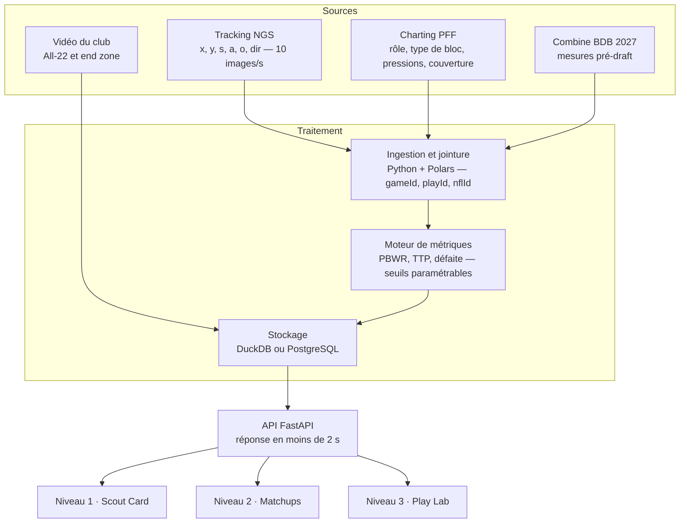

# Cahier des besoins — Outil d'analyse coach NFL

21 octobre 2026

## Synthèse

L'outil doit répondre en moins de 10 secondes à une question de coach, avec la séquence vidéo à l'appui. Il s'appuie sur deux sources réelles qui se joignent par `gameId` / `playId` / `nflId` :
- le tracking Next Gen Stats : position de chaque joueur 10 fois par seconde ;
- le charting PFF : rôle, type de bloc, pression concédée, couverture.

Trois niveaux de lecture, du plus large au plus fin :

1. **Scout Card & Tendencies** : la fiche d'un joueur ou d'une unité, filtrable par situation de jeu.
2. **Matchups & Systèmes** : duels OL contre DL et efficacité des couvertures et des blitz.
3. **Play Lab** : l'action rejouée image par image, synchronisée avec la vidéo.

Trois utilisateurs :
- le coach de ligne, pour le diagnostic technique ;
- le coordinateur, pour repérer les failles de système ;
- le recruteur, pour juger un profil physique en contexte.

Les données imposent deux corrections à la vision de départ :
- le type de bloc PFF décrit la *situation* du bloc (protection standard, play action, switch), pas la technique employée ;
- aucun champ ne donne l'instant de la pression : il faut le calculer à partir du tracking (voir la section Définition des métriques).

## Sources de données réelles

Le jeu de référence pour prototyper est le [Big Data Bowl 2023](https://www.stat.cmu.edu/cmsac/conference/2022/workshop/slides.html), consacré aux linemen sur les jeux de passe. Il couvre 8 557 jeux de passe sur 122 matchs, semaines 1 à 8 de la saison 2021 ([STRAIN, arXiv](https://arxiv.org/pdf/2305.10262)). En production, un club utilise le flux Next Gen Stats complet et l'abonnement PFF, avec le même schéma.

| Fichier | Clé | Champs utiles pour le coach |
| --- | --- | --- |
| `games.csv` | gameId | season, week, équipes domicile / extérieur |
| `plays.csv` | gameId, playId | quarter, down, yardsToGo, gameClock, score, passResult (C, I, S, IN, R), playResult, offenseFormation, personnelO / personnelD, defendersInBox, dropBackType, pff_playAction, pff_passCoverage, pff_passCoverageType |
| `players.csv` | nflId | height, weight, birthDate, collegeName, officialPosition, displayName |
| `pffScoutingData.csv` | gameId, playId, nflId | pff_role, pff_positionLinedUp, pff_hit / pff_hurry / pff_sack (défense), pff_hitAllowed / pff_hurryAllowed / pff_sackAllowed / pff_beatenByDefender (attaque), pff_nflIdBlockedPlayer, pff_blockType, pff_backFieldBlock |
| `tracking` | gameId, playId, nflId, frameId | x, y (yards), s (yards/s), a (yards/s²), dis, o, dir (degrés), event (snap, pass forward, sack…) |

Source du dictionnaire : [documentation BDB](https://github.com/ThompsonJamesBliss/nfl-big-data-bowl-regional-event-data).

**Valeurs codées à exposer telles quelles dans l'interface :**

- `pff_blockType` :
  - PP : protection standard ;
  - PA : protection sur play action ;
  - SW : switch, typiquement sur stunt ;
  - CH : chip ;
  - PU : pickup du backfield ;
  - BH : aide du backfield ;
  - PT : post ;
  - UP : pull en protection ;
  - PR : pocket roll ;
  - SR : set & release ;
  - CL : second niveau ;
  - NB : pas de bloc.
- `pff_passCoverage` : Cover-0, Cover-1, Cover-2, 2-Man, Cover-3, Quarters, Cover-6, Bracket, Goal Line, Red Zone, Prevent, Miscellaneous.
- `pff_role` : Pass, Pass block, Pass route, Pass rush, Coverage.

**Sources complémentaires :**

- **Benchmarks publics** pour calibrer les badges :
  - ESPN publie le PBWR et le PRWR (bloc tenu ou battu en 2,5 s), calculés à partir de Next Gen Stats ([ESPN 2025](https://africa.espn.com/nfl/story/_/id/46138675/2025-nfl-win-rates-top-teams-players-rankings-pass-run-block)) ;
  - PFF a lancé en septembre 2026 son propre PBWR et l'Island Win Rate. Lane Johnson mène 2025 avec 95,6 % de PBWR sur 262 snaps, devant Joe Alt à 95,1 % ([PFF via Fantasy Nerds](https://fantasynerds.com/news/story/2026/09/10/pff-introduces-pass-block-win-rate-lane-johnson-leads-new-metrics-1619384)).
- **Recrutement** : le Big Data Bowl 2027, ouvert le 8 octobre 2026, croise le tracking du Combine 2023-2025 avec les données de match des mêmes joueurs, dont OL et DL ([SVG](https://www.sportsvideo.org/2026/10/08/nfl-announces-ninth-annual-big-data-bowl-powered-by-aws/)). C'est la base du module Scout.
- **Vidéo** : le système vidéo du club (All-22 et end zone), indexé par gameId / playId.

## Besoins par rôle

Chaque question de coach se traduit en une requête sur des champs précis ; si un champ manque, l'outil doit le calculer à partir du tracking.

| Rôle | Question réelle | Données mobilisées | Réponse attendue à l'écran |
| --- | --- | --- | --- |
| Coach OL | Pourquoi mon LT est-il battu à 2,1 s ? | pff_positionLinedUp = LT, pff_*Allowed, pff_beatenByDefender, pff_blockType, tracking LT + défenseur bloqué (pff_nflIdBlockedPlayer) | Instant de la défaite, cause probable (set, switch, puissance), clips triés |
| Coach OL | Mon unité gère-t-elle les stunts ? | pff_blockType = SW, pressions concédées sur ces jeux | Taux de pression sur jeux avec switch vs sans |
| Coach DL | Quel rusher gagne le plus vite, et contre qui ? | pff_role = Pass rush, pff_hit / hurry / sack, tracking distance au QB | Time-to-Pressure par rusher et par OL adverse |
| Coordinateur défensif | Quelle couverture encaisse le plus sur 3rd & long ? | down = 3, yardsToGo ≥ 7, pff_passCoverage, playResult, passResult | Yards par jeu et taux de conversion par couverture |
| Coordinateur défensif | Quel blitz fait pression le plus vite ? | nombre de pff_role = Pass rush par jeu, pff_positionLinedUp des rushers, temps snap → pression | Classement des paquets de pression par Time-to-Pressure médian |
| Coordinateur offensif | Où la défense adverse nous attaque-t-elle ? | defendersInBox, personnelD, pff_passCoverage, alignement des rushers | Tendances adverses par down, distance et formation |
| Recruteur | Un tackle de 315 lbs tient-il un edge rapide ? | players.weight, tracking s du rusher sur ses premières secondes, pressions concédées | Win rate du tackle par tranche de vitesse du rusher, avec clips |
| Recruteur | Les mesures du Combine annoncent-elles ce rendement ? | Combine tracking (BDB 2027) + match | Profil physique comparé aux joueurs NFL du même poste |

Le seuil « 18 mph » du recruteur vaut 8,0 yards/s dans l'unité du tracking. Ce doit être un curseur réglable, calé sur la distribution réelle des vitesses des edge rushers, et non une valeur fixe.

## Niveau 1 — Scout Card & Tendencies

La Scout Card tient sur un écran, et chaque chiffre ouvre la liste des jeux qui le composent.

**En-tête joueur**

- Nom, poste officiel, alignement le plus fréquent (pff_positionLinedUp), taille, poids, âge, université.
- Volume : snaps en protection ou en rush sur la période filtrée. Sous un seuil (par exemple 100 snaps), les pourcentages sont grisés.

**Métriques synthétiques**

| Métrique | Poste | Lecture |
| --- | --- | --- |
| Pass Block Win Rate (PBWR) | OL | Part des snaps sans pression concédée ni défaite |
| Time-to-Pressure médian (TTP) | OL et DL | Secondes entre le snap et l'entrée d'un rusher à moins de 1,5 yard du QB |
| Pressure Rate | OL et DL | Pressions (hurry + hit + sack) par snap |
| Island Win Rate | OT | PBWR sur les snaps sans aide (pas de CH, BH, PU sur son défenseur) |
| STRAIN | DL | Vitesse à laquelle le rusher ferme la distance au QB ([arXiv](https://arxiv.org/pdf/2305.10262)) |

**Radar de compétences (OL)**

Chaque axe correspond à un contexte de bloc, exprimé en win rate :
- PP (protection standard) ;
- PA (play action) ;
- SW (stunt et switch) ;
- Island (seul face au rusher) ;
- contre un rusher rapide ;
- contre un rusher lourd.

Le radar peut se superposer à la moyenne du poste ou à celui d'un autre joueur.

**Radar (DL)** : win rate selon l'alignement (pff_positionLinedUp), contre simple ou double équipe, et sur 3rd down.

**Badges d'alerte**

- Vert : top 10 % du poste sur la métrique.
- Rouge : bottom 10 %, ou écart négatif marqué dans un contexte précis (exemple : PBWR face aux stunts inférieur de 15 points à son PBWR global).
- Ciblage : le joueur est la cible d'un blitz ou d'un stunt adverse plus souvent que la moyenne du poste.

Chaque badge affiche son échantillon (n snaps) pour éviter les fausses alertes.

**Filtres contextuels permanents** :
- down et distance (court ≤ 3, moyen 4-6, long ≥ 7) ;
- quart-temps et score ;
- zone du terrain (red zone) ;
- formation offensive et personnel défensif ;
- couverture, play action oui / non, dropBackType ;
- adversaire et période.

## Niveau 2 — Matchups & Systèmes

Le niveau 2 croise deux entités et répond à « qui gagne quand ». C'est la vue de préparation du match de la semaine.

**Matrice de duels OL × DL**

- Lignes : les 5 OL (LT, LG, C, RG, RT). Colonnes : les rushers adverses. Chaque case donne le nombre de face-à-face (via pff_nflIdBlockedPlayer), le win rate et le TTP médian.
- Un clic sur une case affiche tous les clips de ce duel, triés par instant de défaite.
- Projection : pour le match à venir, les duels attendus selon les alignements habituels de l'adversaire.

**Carte de protection de l'unité**

- Schéma de la ligne vue de dessus, chaque poste coloré selon le Pressure Rate concédé.
- Des flèches indiquent d'où viennent les pressions (gap A, B, C, extérieur). Elles sont calculées à partir de la position du rusher au moment où il franchit la ligne de blocs.

**Tableau de bord défensif (coordinateur)**

- Par couverture (pff_passCoverage) et par situation : yards par jeu, taux de complétion, taux de 1st down concédé, EPA si les données nflverse sont jointes.
- Par paquet de pression, de 3 à 6 rushers et plus (compte de pff_role = Pass rush) : alignement d'origine des rushers, taux de pression, TTP médian, taux de sack.
- Croisement couverture × pression, par exemple Cover-1 avec 5 rushers sur 3rd & long.

**Rapport de tendances adverses (coordinateur offensif)**

- Fréquence de chaque couverture par down, distance, personnel offensif et zone du terrain.
- Fréquence de blitz et rushers les plus utilisés en blitz.
- Indices pré-snap (defendersInBox, personnelD et positions au snap), mis en regard de la couverture jouée.

## Niveau 3 — Play Lab (analyse spatio-temporelle)

Le Play Lab répond au « pourquoi » d'une défaite. Il montre sur une même timeline la vidéo et le tracking à 10 images par seconde.

**Vue terrain animée**

- Les 22 joueurs et le ballon, vue de dessus ; lecture, pause, image par image (0,1 s), ralenti.
- Mise en avant du duel choisi (le bloqueur, son défenseur et le QB), les autres joueurs étant atténués.
- Cercle de 1,5 yard autour du QB ; la poche est dessinée comme le polygone formé par les OL.

**Timeline du duel**

Courbes synchronisées :
- distance rusher → QB ;
- vitesse du rusher (s) ;
- écart de profondeur entre OL et QB ;
- angle entre l'orientation du bloqueur (o) et la trajectoire du rusher (dir).

Marqueurs d'événements : snap, pass forward, sack, instant de défaite calculé.

**Diagnostic assisté** (règles explicables, validées par le coach) :

- *Set* : le rusher passe à l'extérieur alors que le tackle n'a pas reculé assez vite dans les premières images.
- *Switch / stunt* : pff_blockType = SW, et deux bloqueurs se retrouvent sur le même défenseur, ou aucun.
- *Puissance* : le bloqueur recule vers le QB alors que le rusher garde une vitesse élevée face à lui.

L'outil propose une cause probable. Le coach la confirme ou la corrige, et sa correction devient un tag réutilisable.

**Vidéo**

- Clip All-22 et end zone calé sur le snap, avec saut direct à l'instant de défaite.
- Annotations (traits, cercles, commentaire vocal) et playlists partageables avec les joueurs.
- Comparaison côte à côte de deux jeux, par exemple le même stunt réussi et raté.

## Définition des métriques

Chaque métrique a une définition écrite, visible au survol dans l'interface, pour que coach et analyste parlent du même chiffre.

| Métrique | Calcul | Champs |
| --- | --- | --- |
| PBWR (version PFF) | 1 − (snaps avec hurry, hit, sack concédé ou beatenByDefender) / snaps en Pass block | pff_role, pff_*Allowed, pff_beatenByDefender |
| PBWR (version tracking) | Part des snaps où le défenseur bloqué n'entre pas à moins de 1,5 yard du QB avant 2,5 s | tracking, pff_nflIdBlockedPlayer |
| Time-to-Pressure | Première image après le snap où la distance rusher → QB < 1,5 yard, moins l'image du snap, divisé par 10 | tracking x, y, event = ball_snap |
| Instant de défaite | Première image où le rusher passe derrière les épaules de son bloqueur, dans l'axe du QB | tracking x, y, o |
| Pressure Rate | (hurry + hit + sack) / snaps de rush ou de protection | pff_hit, pff_hurry, pff_sack |
| Island Win Rate | PBWR limité aux snaps où aucun autre bloqueur (CH, BH, PU, SW) ne touche le même défenseur | pff_blockType, pff_nflIdBlockedPlayer |
| Nombre de rushers | Compte des joueurs pff_role = Pass rush sur le jeu ; blitz si plus de 4 | pff_role |
| Vitesse du rusher | Vitesse maximale (s) dans les 1,5 premières secondes après le snap | tracking s |
| Yards par jeu concédés | Moyenne de playResult par couverture et situation | plays.csv |

La distance au QB se calcule ainsi, à chaque image :

```latex
d(t) = \sqrt{(x_{R}(t) - x_{QB}(t))^2 + (y_{R}(t) - y_{QB}(t))^2}
```

Les seuils (1,5 yard, 2,5 s) sont des paramètres de l'outil. Le seuil de 2,5 s est le standard ESPN. Celui de 1,5 yard est une proposition de ce cahier, à valider sur des clips avec le staff.

## Exigences priorisées

Le MVP couvre le coach de ligne sur les données BDB 2023. Les versions suivantes ajoutent les coordinateurs, puis le recrutement.

| Version | Fonctionnalité | Rôle servi | Critère d'acceptation |
| --- | --- | --- | --- |
| MVP | Scout Card OL avec PBWR, TTP, Pressure Rate | Coach OL | Fiche d'un joueur affichée en moins de 2 s, chiffres identiques au recalcul manuel |
| MVP | Filtres down, distance, quart-temps, couverture, formation | Tous | Tout filtre met à jour la carte sans rechargement |
| MVP | Vue terrain animée d'un jeu avec duel mis en avant | Coach OL | Lecture fluide à 10 images/s, image par image |
| MVP | Liste des défaites triées par instant de défaite | Coach OL | Chaque ligne ouvre le jeu au bon instant |
| V2 | Matrice de duels OL × DL | Coachs de ligne | Nombre de face-à-face affiché dans chaque case |
| V2 | Tableau couverture × situation et paquets de pression | Coordinateurs | Requête « 3rd & 7+ par couverture » en 1 clic |
| V2 | Synchronisation vidéo All-22 | Tous | Clip calé sur le snap à ±1 image |
| V2 | Diagnostic assisté et tags du coach | Coach OL | Le coach valide ou corrige une cause en 1 clic |
| V3 | Module Scout : Combine × match | Recruteur | Comparaison d'un prospect aux joueurs NFL du poste |
| V3 | Radar comparatif et badges top / bottom 10 % | Recruteur, coach | Échantillon affiché sur chaque badge |
| V3 | Rapport adverse exportable (PDF) et playlists | Coordinateurs | Rapport généré le lundi pour le match suivant |

**Exigences non fonctionnelles**

- Rapidité : toute question courante obtient sa réponse en moins de 10 s, de la saisie au clip.
- Usage : tablette en salle de réunion et sur le bord du terrain, mode sombre, gros éléments tactiles.
- Vocabulaire : termes du football (set, stunt, gap A), jamais de nom de colonne brut.
- Confidentialité : données PFF et NGS sous licence, accès par rôle, aucun partage hors du staff.
- Traçabilité : chaque chiffre renvoie aux jeux qui le composent.

## Architecture et outils recommandés

Une pile légère et open source suffit pour le MVP : Python pour calculer, une base analytique pour stocker, une interface web pour tablette.



Les métriques sont calculées une fois par match, puis stockées. L'interface ne fait que filtrer, ce qui garde chaque réponse sous 2 s.

| Brique | Outil proposé | Raison |
| --- | --- | --- |
| Calcul | Python, Polars ou pandas, NumPy | Traite des millions de lignes de tracking par saison |
| Stockage | DuckDB (prototype), PostgreSQL (club) | Requêtes analytiques rapides sur fichiers CSV / Parquet |
| API | FastAPI | Expose les filtres et les métriques à l'interface |
| Interface | React, D3 pour radars et matrices, Canvas pour le terrain animé | Fluide sur tablette |
| Vidéo | Lecteur HTML5 relié au système vidéo du club | Saut au bon instant par gameId / playId |
| Données complémentaires | nflverse (EPA, jointure via old_game_id et play_id) | Valeur de chaque jeu, gratuite |

## Limites des données et risques

Le principal risque est de présenter comme certain ce que les données ne disent pas. L'interface doit donc montrer l'échantillon et l'origine de chaque chiffre.

- **Échantillon** : le BDB 2023 couvre 8 semaines d'une seule saison (2021). C'est suffisant pour prototyper, mais trop court pour juger un joueur ; il faut le flux NGS complet du club.
- **Pas d'horodatage des pressions** : hurry, hit et sack PFF sont des indicateurs par jeu. L'instant de la pression doit être calculé, avec une marge d'erreur d'environ 0,1 s (une image).
- **Pas de technique de rush** : aucun champ ne décrit un « spin », un « bull rush » ou un « long-arm », ni ne nomme le stunt joué. Seul SW signale un switch. Le diagnostic reste donc une hypothèse que le coach valide.
- **Pas de champ blitz** : le blitz se déduit du nombre de rushers et de leur alignement.
- **Charting humain** : les étiquettes PFF ne sont pas exactes à 100 %. Les écarts entre PBWR PFF et PBWR tracking doivent être signalés, pas masqués.
- **Dépendance au QB** : un QB qui garde le ballon longtemps fait baisser le PBWR de sa ligne. Le temps avant la passe doit être affiché à côté.
- **Licences** : PFF et NGS restent propriétaires ; le BDB est réservé à un usage non commercial dans le cadre de Kaggle.
